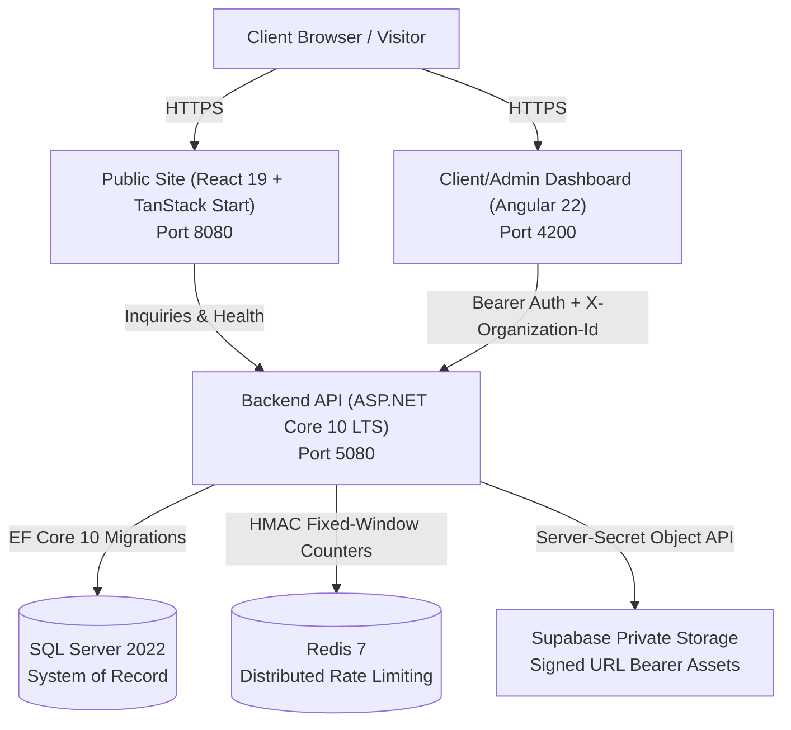

# <p align="center"><br>DigiSay Group — Digital Media Solutions Platform</p>

<p align="center">
  <a href="https://github.com/X-Codex-Ar/Digisay-Digital-Eg-Full/actions/workflows/ci.yml"></a>
  
  
  
  
  
  
</p>

---

## ✦ Platform Overview

**DigiSay Group** is the leading digital media solutions provider and content rights powerhouse across the Middle East, North Africa, and global creator ecosystems. This repository houses the enterprise monorepo underpinning DigiSay's public presence, client portal, administrative command center, and backend services.

The platform is engineered around three pillars:
- **Public Digital Showcase (`public/`):** Cinematic, high-performance SSR web experience built with **React 19**, **TanStack Start**, **TanStack Router**, and programmatic physics-based **Motion** adhering to `prefers-reduced-motion`.
- **Client & Admin Dashboard (`dashboard/`):** Unified, responsive management workspace built with **Angular 22.3** and modular Tailwind tokens, providing multi-tenant client self-service and administrative CRM operations.
- **Backend Clean Architecture (`backend/`):** Robust, high-throughput modular monolith built with **ASP.NET Core 10 LTS**, **Entity Framework Core 10**, **Microsoft SQL Server 2022**, and **Redis** distributed rate limiting.

---

## ✦ Architecture & Live Status



### Module Status Matrix

| Module / Capability | Technology | Status | Key Features |
| :--- | :--- | :--- | :--- |
| **Public Showcase** | React 19, TanStack Start, Tailwind v4 |  **Production-Ready** | SSR, Motion physics, Contact Form with honeypot & feedback, Analytics Consent Manager |
| **Client Portal** | Angular 22.3, Signals, Standalone |  **Active** | Service request creation, scoped tracking, organization selector, role guard |
| **Admin Operations** | Angular 22.3, Role Guards |  **Active** | Lead lifecycle transitions, follow-up history, client request triage |
| **Identity & Access** | ASP.NET Core Identity |  **Active** | 15m Bearer tokens, 7d refresh rotation, SecurityStamp session revocation, RBAC |
| **Multi-Tenant Isolation** | Custom Context Middleware |  **Active** | `X-Organization-Id` verified against user memberships; cross-tenant access returns 404 |
| **CRM Lifecycle** | Domain Entities + SQL Server |  **Active** | Concurrency rowversion protection (HTTP 409), escaped partial search, audit actors |
| **Private Binary Storage** | Supabase Storage + SQL Server |  **Active** | Strict MIME & signature verification (PDF/JPEG/PNG), 5-min signed download links |
| **Rate Limiting** | Redis 7 + Lua Scripting |  **Active** | Distributed atomic fixed-window counters, HMAC-SHA256 privacy-preserving key hashing |

---

## ✦ Repository Structure

```text
.
├── public/                 # React 19 / TanStack Start public web application
├── dashboard/              # Angular 22.3 client portal and admin dashboard
├── backend/                # ASP.NET Core 10 Clean Architecture solution
│   ├── src/
│   │   ├── DigiSay.Domain           # Core business entities, invariants, value objects
│   │   ├── DigiSay.Application      # Use cases, commands, queries, store abstractions
│   │   ├── DigiSay.Infrastructure   # EF Core 10, SQL Server, Redis, Supabase adapters
│   │   └── DigiSay.API              # Minimal API endpoints, middleware, configuration
│   └── tests/                       # Unit, integration, and SQL Server test suites
├── database/               # SQL Server migrations, ownership docs, and operational scripts
├── storage/                # Media storage architecture, static master assets, and bucket schemas
├── ai-agents/              # AI specifications, evaluation fixtures, and roadmap architecture
├── devops/                 # Containerization, deployment templates, and cloud architecture
├── docs/                   # Exhaustive architecture, API, security, and integration docs
├── compose.yaml            # Docker Compose orchestration for full local platform stack
└── .github/workflows/      # CI Quality Gates (.NET, React, Angular) and automation
```

---

## ✦ Quick Start

### 1. Run Everything via Docker Compose

The fastest way to spin up the entire ecosystem (SQL Server, Redis, Backend API, Dashboard, Public Site):

```powershell
docker compose up -d
```

| Service | Local URL | Description |
| :--- | :--- | :--- |
| **Public Website** | [http://localhost:8080](http://localhost:8080) | React 19 public showcase |
| **Dashboard** | [http://localhost:4200](http://localhost:4200) | Angular client and admin portal |
| **Backend API** | [http://localhost:5080](http://localhost:5080) | ASP.NET Core API |
| **API Health** | [http://localhost:5080/health/ready](http://localhost:5080/health/ready) | SQL Server & dependency readiness check |
| **SQL Server** | `127.0.0.1:1433` | Microsoft SQL Server 2022 instance |

*(Note: EF Core migrations are opt-in; `docker compose up` never applies them automatically. After reviewing a migration, use the explicit PowerShell sequence in [Docker development docs](docs/development/DOCKER.md#start-the-full-stack) to apply it to the local Compose database.)*

---

### 2. Local Monorepo Development

Install dependencies across all workspaces:

```powershell
pnpm run install:all
```

Run independent development servers:

```powershell
# Run Public React (SSR with Vite)
pnpm run dev:public

# Run Angular Dashboard
pnpm run dev:dashboard

# Run ASP.NET Core Backend
pnpm run dev:api
```

---

## ✦ Database Migrations

SQL Server is the authoritative source of truth. Schema updates are versioned with EF Core:

```powershell
# Install matching EF Core CLI tool
dotnet tool install --global dotnet-ef --version 10.0.15

# Apply pending migrations to your configured database
dotnet ef database update --project backend/src/DigiSay.Infrastructure --startup-project backend/src/DigiSay.API
```

For local secret configuration, use ASP.NET User Secrets:

```powershell
cd backend/src/DigiSay.API
dotnet user-secrets set "ConnectionStrings:SqlServer" "Server=127.0.0.1,1433;Database=DigiSay;User Id=sa;Password=<YourStrongPassword>;Encrypt=False;TrustServerCertificate=True"
```

---

## ✦ Testing & Quality Gates

Every pull request and merge to `main` must pass all three required GitHub status checks:

```powershell
# 1. Public React (Lint, Tests, Build)
pnpm --dir public run lint
pnpm --dir public run test
pnpm --dir public run build

# 2. Angular Dashboard (Tests, Build)
pnpm --dir dashboard run test --watch=false
pnpm --dir dashboard run build

# 3. Backend .NET 10 (Locked Restore, Build, Tests)
dotnet restore backend/DigiSay.sln --locked-mode
dotnet build backend/DigiSay.sln --configuration Release --no-restore
dotnet test backend/DigiSay.sln --configuration Release --no-build --no-restore
```

> **Integration Tests:** The backend test suite includes 36 comprehensive integration tests verifying multi-tenant isolation, rowversion concurrency, and SQL Server persistence against a live or containerized instance. Set `TEST_SQLSERVER_CONNECTION_STRING` when running integration tests locally.

---

## ✦ Design System & Brand Identity

DigiSay's visual identity balances high-impact digital entertainment with institutional trust:

- **Brand Crimson (`#d90a2c`):** Signature accent, active states, and glowing brand lines.
- **Deep Obsidian (`#090a0d`, `#111215`):** Cinematic dark canvas for showcases and dashboards.
- **Pure White & Muted Slate (`#ffffff`, `#9ca3af`):** High-contrast typography and subtle borders.
- **Motion Principles:** Cubic-bezier transitions, spring-physics magnetics, velocity tickers, and strict adherence to `prefers-reduced-motion`.

---

## ✦ Comprehensive Documentation

Explore in-depth documentation across all platform dimensions:

### Architecture & Design
- [System Architecture](docs/architecture/SYSTEM-ARCHITECTURE.md) — End-to-end topology and request flow
- [Clean Architecture Boundaries](docs/architecture/CLEAN-ARCHITECTURE.md) — Layer separation and dependency rules
- [Domain Modules Status](docs/architecture/DOMAIN-MODULES.md) — Detailed capability catalog
- [AI Engineering Roadmap](ai-agents/README.md) — Assistive workflows, evaluation, and safety gates

### Security & Governance
- [Authentication & Authorization](docs/security/AUTHENTICATION-AUTHORIZATION.md) — Identity, RBAC, tokens, session revocation
- [Security Requirements](docs/security/SECURITY-REQUIREMENTS.md) — Hardening, rate limiting, and CORS
- [Security Policy](SECURITY.md) — Vulnerability disclosure process

### APIs & Data
- [API Conventions](docs/api/API-CONVENTIONS.md) — REST patterns, error models, and headers
- [Private Storage API](docs/api/PRIVATE-STORAGE.md) — File uploads, signed URLs, and tenant checks
- [SQL Server Schema](docs/database/SQL-SERVER-SCHEMA.md) — Tables, migrations, and concurrency
- [Supabase Integration](docs/integrations/SUPABASE-INTEGRATION.md) — Binary bucket configuration

---

<p align="center">
  <sub>Designed & Engineered for <b>DigiSay Group</b>. Built with precision and modern web standards.</sub>
</p>
