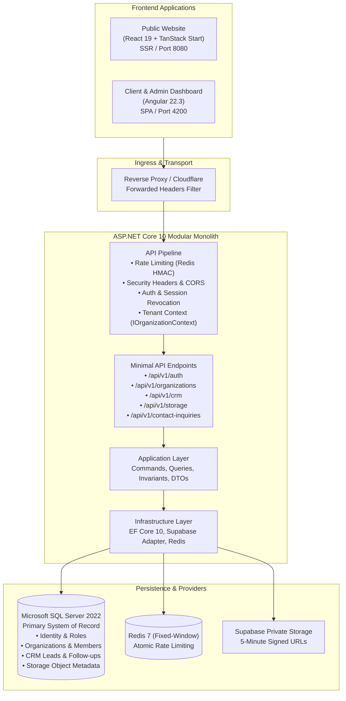

# System Architecture

  
  
  

---

## ✦ System Topology & Data Flow

DigiSay is architected as an independently deployable frontend monorepo paired with a robust ASP.NET Core 10 modular-monolith backend:

---

## ✦ Security & Multi-Tenant Boundaries

1. **Authentication & Session Security:**
   - Identity authority resides exclusively in ASP.NET Core Identity on SQL Server.
   - 15-minute bearer tokens in memory, 7-day rotating refresh tokens.
   - Instant session revocation via `SecurityStamp` rotation; refresh reuse is detected and blocked.
2. **Tenant Context Enforcement:**
   - Every tenant-scoped request requires an `X-Organization-Id` header.
   - `IOrganizationContext` validates that the authenticated caller has an active membership in the requested organization.
   - Cross-tenant queries return HTTP 404 to avoid leaking tenant existence.
3. **Distributed Rate Limiting:**
   - Powered by Redis Lua scripts implementing fixed-window sliding counters.
   - Client IPs/UserIds are hashed using HMAC-SHA256 with a private salt before reaching Redis.
4. **Binary Asset Protection:**
   - Uploads require organization owner roles, validated file signatures (magic bytes for PDF, PNG, JPEG), and a 10MB limit.
   - Downloads use short-lived (5-minute) signed URLs generated server-side.
